<p align="center">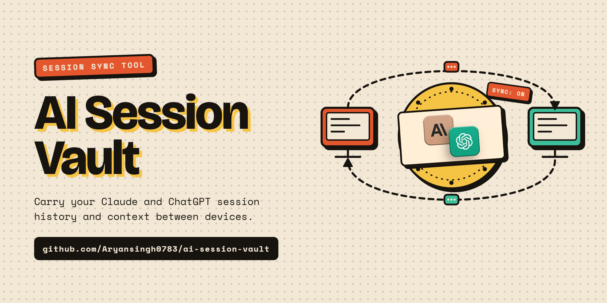</p>

# AI Session Vault

Carry your Claude Code, Codex and Claude Desktop sessions between computers. Everything in the vault is
encrypted, and a plain file-sync tool (OneDrive, Google Drive, Dropbox, Syncthing, a USB stick) can't corrupt it.

New here? Read the [guide](docs/GUIDE.md): what it does, a 5-minute start, how to read the app, tips and troubleshooting.

Status: **core, CLI and app UI working** (`avault`, `avault ui`), 43 automated tests.

```
crates/vault-core   library: crypto, vault store, sync engine, archive/search, doctor (no UI)
crates/vault-cli    `avault` command line, with --json output
crates/vault-ui     the app: a local web UI (iDraft-style design) served by the Rust core, over the live engine
```

## Screenshots

<p align="center">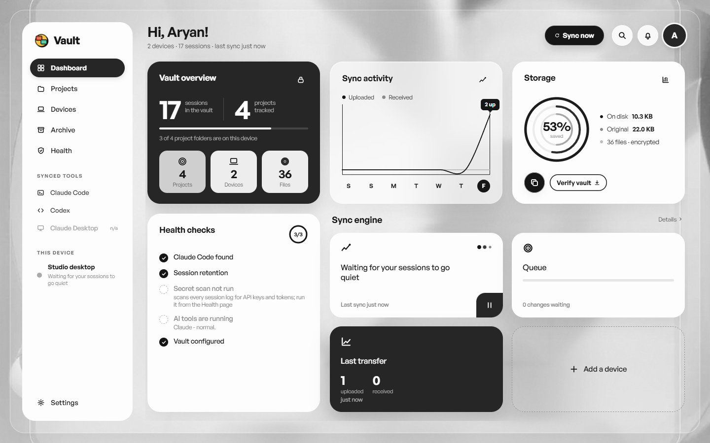</p>

| | |
|---|---|
| 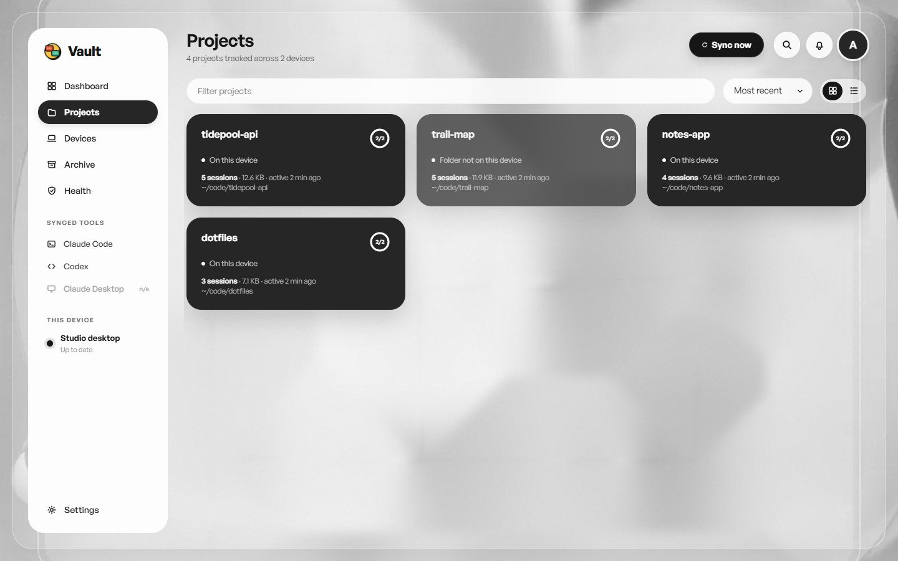 **Projects** from every device, with the folder status on this one. | 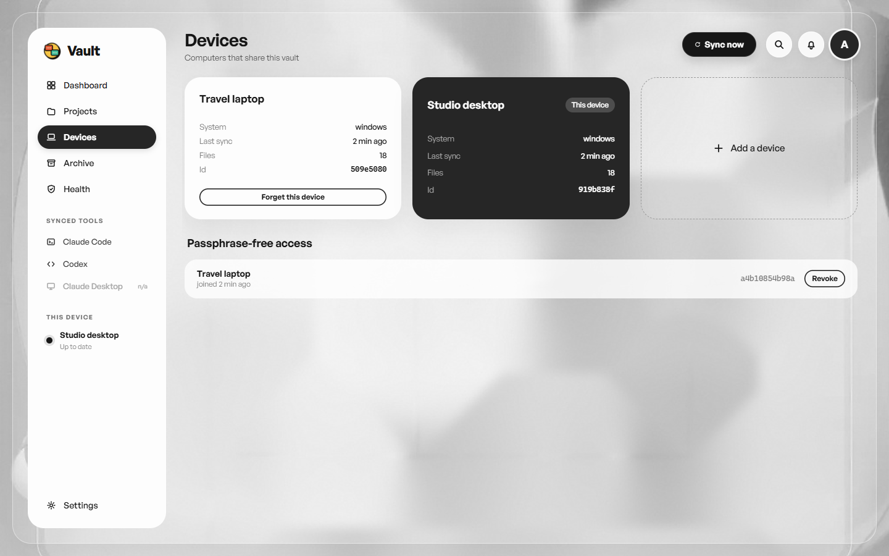 **Devices** sharing the vault, and passphrase-free access you can revoke. |
| 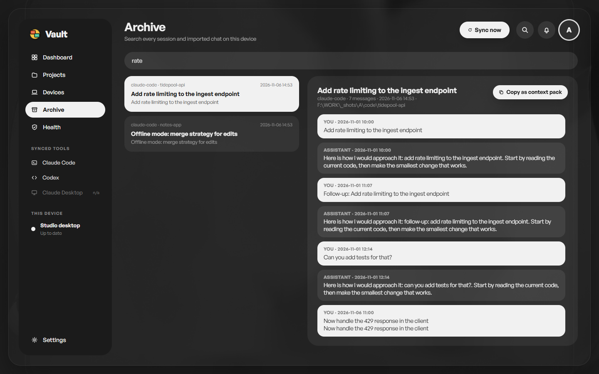 **Archive**: search and read any session, or copy it as a context pack for a new chat (dark theme). | 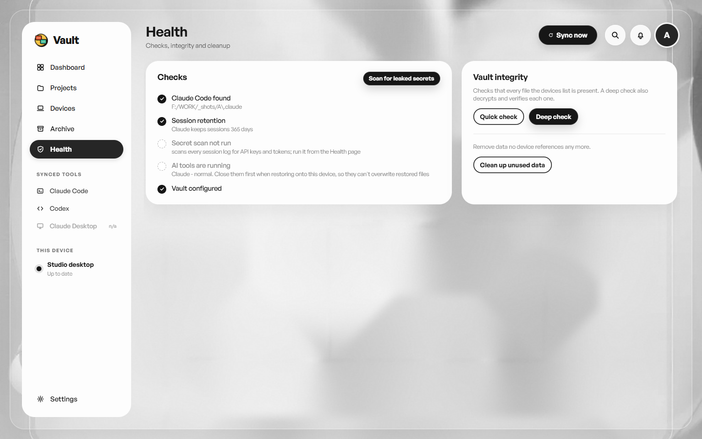 **Health**: checks, integrity verification and cleanup. |
| 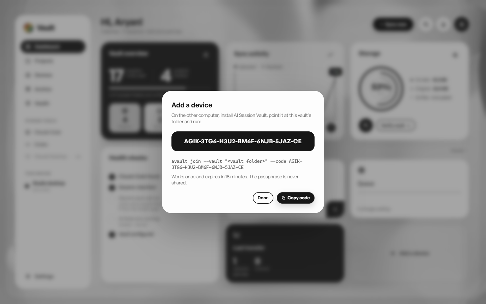 **Add a device** with a one-time code. The passphrase is never shared. | 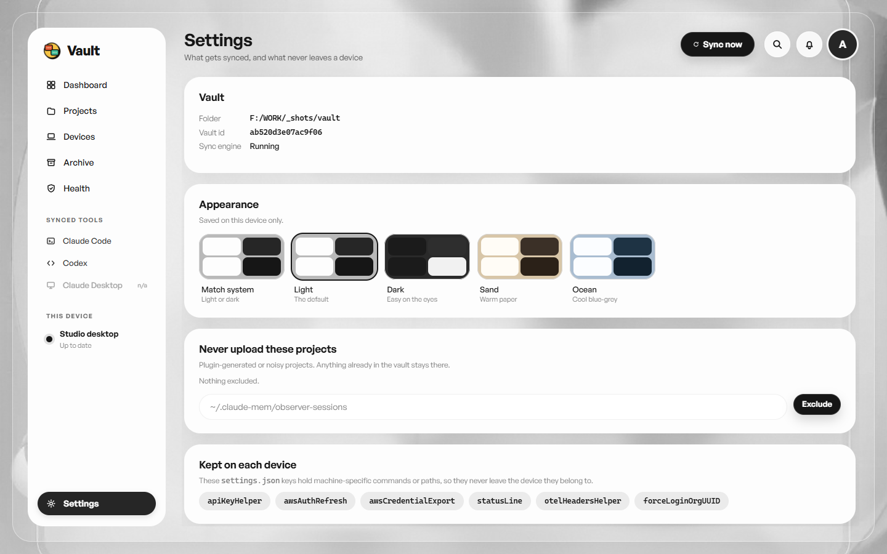 **Settings**: five themes, saved per device. |

Same dashboard in the other themes:

| Dark | Sand | Ocean |
|---|---|---|
| 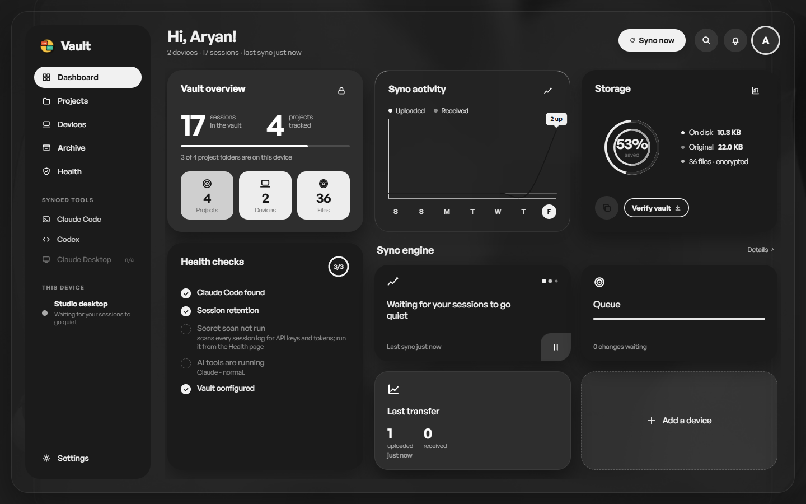 | 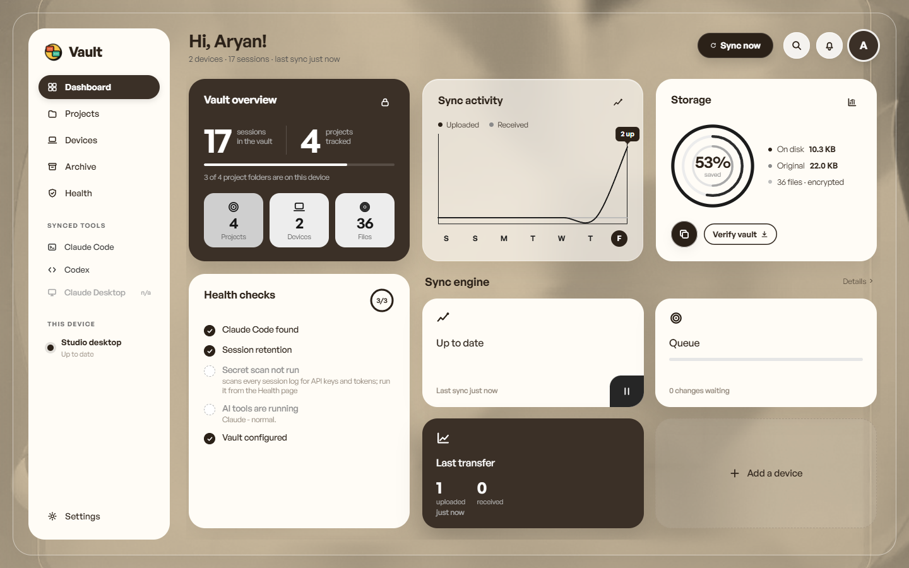 | 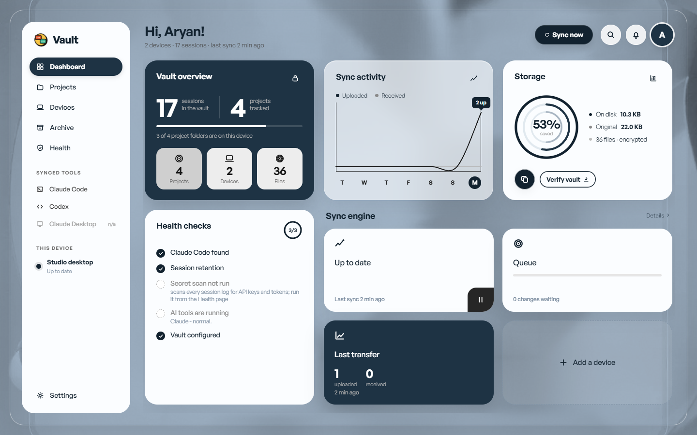 |

(Screenshots use a demo vault with made-up sessions.)

## Install

**Windows:** download `AI-Session-Vault-Setup-<version>.exe` from the [Releases page](https://github.com/Aryansingh0783/ai-session-vault/releases) and run it. It installs for your user only (no administrator prompt), adds a Start Menu entry, and can start the app when you sign in. The installer is not code-signed yet, so Windows SmartScreen may say "unknown publisher": choose *More info*, then *Run anyway*.

Open **AI Session Vault** from the Start Menu. The first time, the app asks whether this is your first computer (create a vault) or you already have one (connect to it). No terminal is needed.

There is also a portable zip (`avault.exe` and `avault-window.exe`) and tarballs for macOS and Linux; those are command-line first: unpack, then run `avault app` (or `avault` on its own, which opens the app) from a terminal. Or build it yourself: `cargo build --release`.

## Quick start

In the app: **first computer** > create a vault in a cloud-synced folder, choose a passphrase, save the recovery key. **Every other computer** > "I already have a vault", pick the same folder, enter the passphrase (or a one-time code from Devices > Add a device).

The same from a terminal:

```
avault                                         # open the app (window + tray icon); first run shows the setup screen
avault init --vault "D:\OneDrive\AI Vault"     # create a vault from the terminal; prints a recovery key - keep it
avault sync                                    # pulls others' changes, then publishes yours
avault ui                                      # the same app in your browser
```

## What changed from the Python version

| Python v1 | Rust v2 |
|---|---|
| Session logs stored as plaintext in the vault; only config secrets encrypted | **Everything** compressed + encrypted (XChaCha20-Poly1305); object ids are keyed hashes |
| Passphrase lost = vault lost | Random master key wrapped by passphrase **and** a recovery key; `passwd` re-wraps without re-encrypting |
| Newest-wins by mtime: a session continued on two devices loses one side | JSONL logs are **merged by line union**; nothing is overwritten |
| One shared `signatures.json` / `manifest.json` (cloud-sync conflict magnet) | Write-once objects + one manifest per device: **no file is ever written by two machines** |
| `settings.json` replaced wholesale | Merged **key by key**; machine-specific keys (`statusLine`, `apiKeyHelper`, `awsAuthRefresh`, ... editable via `local_keys` in `~/.ai-vault/config.json`) never leave their device |
| Text edited on two devices: silent loser | `CLAUDE.md`, memory notes, rules, TOML are **merged three-way** when the edits touch different lines; overlapping edits fall back to newest-wins with a safety copy |
| Config edited on two devices: silent loser | Conflict detected via last-synced hash, reported, loser saved to `~/.ai-vault/safety-copies` |
| Re-read every file each run, whole files in memory | Size+mtime hash cache; files stream through 1 MiB encrypted chunks, so a growing session log uploads only its new tail, memory stays bounded, plain files have no size limit, and an interrupted run resumes (checkpoints) |
| One-shot script, polling | **Always-on engine** (`vault_core::engine`): watches your tools' folders and the vault folder, waits for a session to go quiet, then does an incremental sync; periodic full sync as a safety net; exponential backoff when the cloud folder isn't ready; pause / resume / cancel; typed event stream (status, progress, finished, error) for a UI |
| Skipped a half-written last line? No | Trailing partial lines of live logs are never shipped |
| No guard against Claude's 30-day purge | Deletions are never synced; `doctor` warns about `cleanupPeriodDays` |
| Windows Store (MSIX) Claude Desktop config missed | Probes both config locations |
| Archive was a separate plaintext folder | Archive conversations sync (encrypted) like everything else |
| Python + PyInstaller (SmartScreen warnings) | Single static binary |

## The app (`avault ui`)
A local web app in the iDraft design language (glass shell, white sidebar, dark cards, pill buttons; loaders from the loader sheet), served by the Rust core on `127.0.0.1` with a per-run access token and Host/Origin checks. It shows the vault overview, a 7-day sync activity chart, storage savings, health checks, live engine status (progress over server-sent events), projects, devices (add a device with a one-time code, revoke access), a search/reader for every session with "copy as context pack", integrity checks, and settings (project exclusions). Five themes (match system, light, dark, sand, ocean) are in Settings > Appearance. `avault ui --read-only` shows the vault without running the sync engine.

**Native window + tray (`avault app`, or just open the installed app).** `avault-window` is the program you launch: it starts the engine and the local UI in the background, then shows them in the system webview (WebView2 on Windows). Closing the window hides it to the tray and syncing continues; the tray menu has Open, Sync now, Pause, Resume and Quit. Opening the app a second time just brings the running window to the front. If the webview can't start, the app opens in your browser instead.

## How the vault works

```
vault/
  vault.json                   KDF params + wrapped master key slots (passphrase, recovery)
  objects/ab/<id>              immutable encrypted file versions (write-once)
  devices/<id>/manifest        encrypted; only that device writes it
```
`sync` = restore (merge others in) then backup (publish yours), like `git pull && git push`.
Project folders are matched by portable path (`~/code/app`), so `C:\Users\you\code\app` and
`/home/you/code/app` line up; `--map OLD=NEW` handles anything outside your home folder.
Only structured `cwd` fields in logs are rewritten; message text is never touched.
Logins (`.credentials.json`, `auth.json`) and `settings.local.json` never leave the device.

## Tested on real data
A read-only backup of a real `~/.claude` + `~/.codex` (3,177 files, ~1.3 GB of sessions) produced a 227 MB encrypted vault in 21 s; the next run took 0.4 s; `verify --deep` passed. 1,077 of 1,099 session logs came from a plugin's observer sessions, hence `avault exclude`.

## Roadmap (from the pain-point research)

Done: autostart at login, device enrollment with revocable access (`enroll` / `join` / `devices --revoke`), three-way merge of text files, project exclusion, OS keychain storage (`remember`), UI view-model API (`vault_core::overview`), key-level `settings.json` merge with per-machine keys, `--block-secrets`, consistent snapshots of live SQLite databases (Codex history) via SQLite's backup API, `verify`, `devices`, chunked streaming storage, always-on engine, `--redact`, Python-vault import, portable project ids, log merge, conflict detection, encryption of everything, recovery key, atomic writes,
partial-line guard, MSIX desktop path, secret scan in `doctor`, retention warning.

Next:
2. Streaming merge for logs over 2 GiB (smaller logs merge in memory; larger ones are skipped and reported). Content-defined chunking if edits-in-the-middle ever matter.
4. A real Windows service wrapper (autostart at login already exists: `avault autostart enable`). Tray status badges for conflicts and errors.
6. Per-OS layers for `settings.json` (key-level merge and per-machine keys already exist).
7. Full key rotation (re-encrypt) so a revoked device that already copied the key is locked out too.
8. Full-text index (tantivy) and neutral session schema for Codex rollouts.
9. `relocate` command and a per-Claude-version compatibility self-test for the project-folder encoding.
10. Import v1 settings/MCP (their encrypted fields) - needs scrypt + AES-GCM decrypt.
